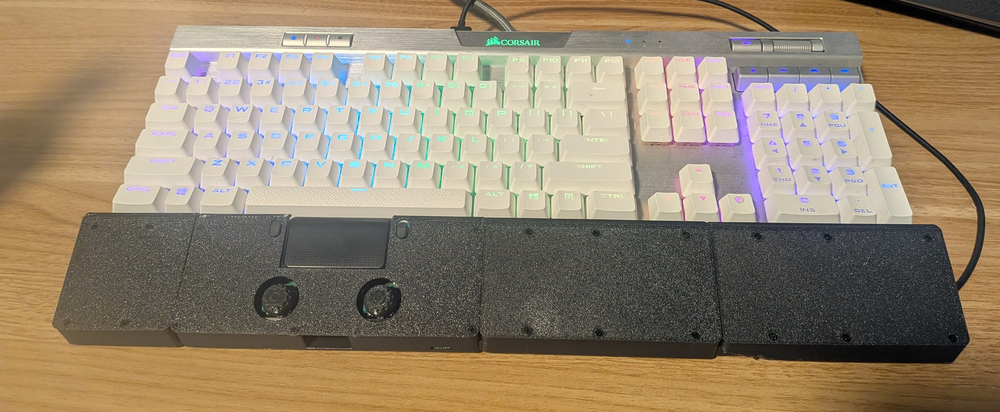
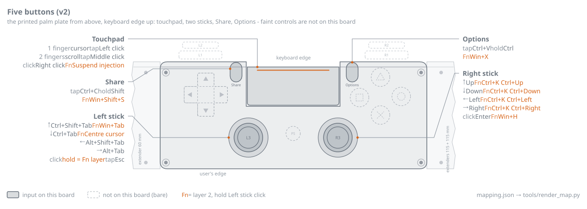
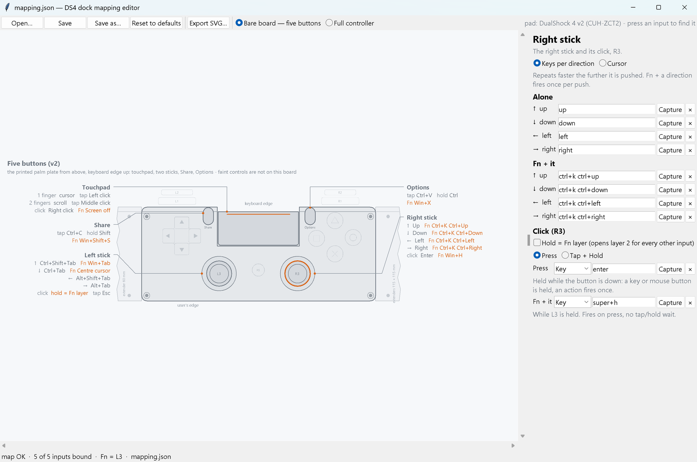
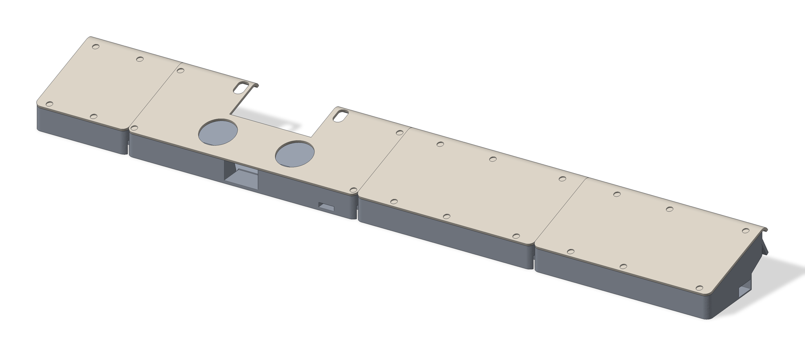
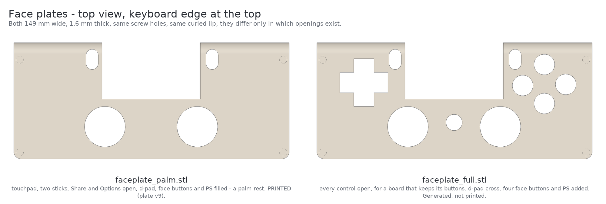
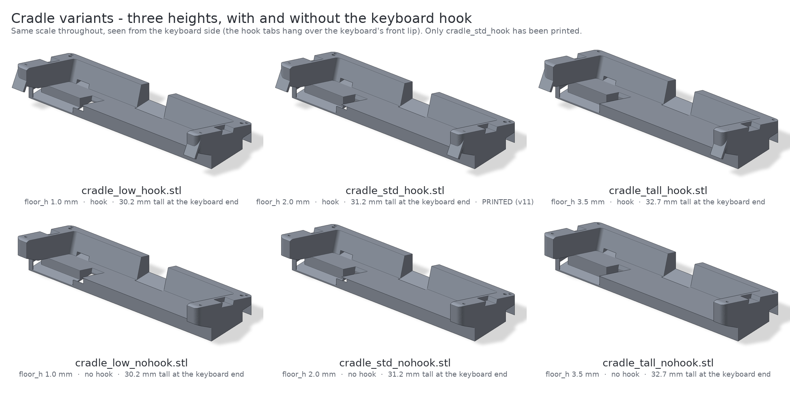

# DS4 dock

[](https://github.com/Eliezer-Davidson/ds4dock/actions/workflows/tests.yml)
[](LICENSE)
[](ds4_dock.py)

A DualShock 4, stripped to its board and rebuilt as the wrist rest in front of my keyboard - and a touchpad, a macro pad and a status light while it is there. Stock firmware, no soldering: one Python file on the host does all of it.



*Photograph: the v11 frame as assembled on 2026-10-21 and in use since - the 60 mm left extender, the cradle with the touchpad and the two sticks, and the two 115 mm right extenders, each piece with its own plate - in front of the Corsair K70.*

## TL;DR

- **Everything is host-side.** `ds4_dock.py` reads the pad over USB HID at 250 Hz and injects input: touchpad = cursor, tap and two-finger scroll; right stick = arrow keys; left stick = window and tab switching; five physical buttons = keys, chords and a momentary **Fn** layer that buys back the rest.
- **The light bar is a status light.** Blue in use, magenta on the Fn layer, off when idle and while the dock has the screens blacked out (**Fn** + pad click) - and **orange when something wants your attention**, screen off or not, driven by a one-word file that Claude Code hooks (the documented example) write.
- **A parametric, printed frame** holds the board at 17 degrees: a cradle, a face plate and wrist extenders that bring it out to the 439 mm of a Corsair K70 and hook over the keyboard's front lip. All four pieces come from one parameter file, and 34 STL files are pre-built: 26 variants across three heights, with and without the hook, and two face plates, plus the extender plates, the joint keys and the stick caps.
- **Reproducible and checked.** A hardware-free self-test runs in CI on Linux and Windows, the CAD has its own geometric check suite, and a tkinter editor remaps every reachable input without touching code.

## Contents

[At a glance](#at-a-glance) · [Status](#status) · [What it does](#what-it-does) · [Why](#why) · [How it works](#how-it-works) · [Quick start](#quick-start) · [Customising](#customising) · [The frame](#the-frame) · [Bill of materials](#bill-of-materials) · [Repository map](#repository-map) · [Further reading](#further-reading) · [Built with](#built-with) · [License](#license)

## At a glance

| | |
|---|---|
| Controller | DualShock 4 v2 (CUH-ZCT2), JDM-055 mainboard, stock firmware, USB VID `054C` PID `09CC` |
| Kept inputs | touchpad (two contacts) + its click, both sticks + their clicks (L3, R3), Share, Options - five buttons |
| Removed | shell and grips, triggers, rumble motors, battery (optional on USB), rear shell with L1/R1 |
| Host side | one file, `ds4_dock.py`: standard library + `hidapi` (+ `evdev` on Linux); `SendInput` on Windows, `uinput` on Linux |
| Rates | 250 reports/s; read + parse loop measured at 5.3 % of one core |
| Frame | PETG on a Bambu Lab A1 mini; cradle 149 mm + extenders 60 and 2 x 115 mm = 439 mm, tilt 17 degrees |
| Keyboard | Corsair K70 RGB MK.2 SE (437 x 165 x 38 mm, front lip ~18-20 mm) |
| Config | `mapping.json` (the control map) and `tune.json` (feel), both re-read live when they change; `attention_state.txt` (one word, polled) |
| Tests | `python ds4_dock.py --selftest`, `python tools/mapping_editor.py --selftest`, `python cad/checks.py`; CI on Ubuntu + Windows, Python 3.11 and 3.13 |
| License | CC BY-NC 4.0 - free for personal use and modification, commercial use by permission |

## Status

As of 2026-10-22, plus the screen-off row from 2026-10-26. The point of this repository is that it is honest, so this table says what has actually happened.

| Area | State |
|---|---|
| Mapper on Windows | Works end to end on the real board. The phase-1 hardware checklist passed 2026-09-22 (every input readable, 250 Hz, light bar writable); injection was live-tested the same day and the default feel values have stayed. The autostart watcher has been in place since 2026-10-05; the pad itself went dead at about the same time and stayed dead until 2026-10-20, when its USB port board was replaced ([docs/HARDWARE.md](docs/HARDWARE.md#the-usb-port-board-swap)) and the watcher picked it up on its own. Control map v2 (2026-10-21) is the running map and the self-test is green; its button-by-button walk on the hardware has not been written up yet. |
| Mapper on Linux | The `evdev`/`uinput` backend is written and grabs the kernel's own DS4 touchpad device so the cursor is driven once - but it has **never been run on hardware**. |
| Screen off | Added on 2026-10-26, on `Fn` + pad click - the chord that was suspend. It is a black window over each monitor rather than a monitor-off, which on Modern Standby laptops like this one has been reported to put the whole PC into standby (never tried here), and it watches the keyboard and the mouse itself because Windows' own idle clock never stops moving while the dock is plugged in ([docs/HARDWARE.md](docs/HARDWARE.md#l2--r2-without-triggers)). The self-test covers the mapper's side, and the curtain's own logic against a stand-in for Windows, and passes. The curtain itself was raised for real on this machine as a 60 x 60 px test square: it came up in under 10 ms, stayed up while the idle clock moved, was rebuilt after a display-change message, and came down on an injected mouse event, after a lost heartbeat and on request. Full-screen, from the real chord, woken by the real keyboard, mouse or touchpad or by a touch or a pen on the screen, and through a long dark spell with a download and audio running, it has **not been tried yet**. Windows only. On Linux and with `--no-inject` the chord still lets go of anything held and the pad goes quiet for 0.4 s; then the mapper carries on as normal, and Linux prints one line saying screen off is Windows-only. |
| Frame | **v11: printed, assembled on 2026-10-21 and in use** - the photograph at the top. The complete set (cradle, the three extender bases and their plates, splines, top keys, stick caps) was sliced into three plates - 8 h 14 m, 205 g of PETG - and uploaded on 2026-10-12; the face plate on it is plate v9, printed earlier and unchanged since. The prints that taught v11 what to fix are superseded: cradle v10, the one-piece v2 extenders that reached the printer (the left one, and the outermost right one, which came off without its keyboard undercut) and a v10 test plate. A fit report for v11 - seams, keys, the hook on the keyboard's lip - has not been written up; what exists is the photograph and the fact that it is in use. |
| Variants | `std` height + `hook` + `palm` plate is the only configuration that has been printed. `low`, `tall`, `nohook` and the `full` face plate are generated from the same parameters by `cad/variants.py` and checked by `cad/checks.py`, and have never been printed. |
| CAD checks | `python cad/checks.py` exits 0, with two rows reported as `KNOWN` rather than `PASS`: the cradle's two front plate-screw pilots sit inside the 9 mm that the spline seat reaches into the cradle, so those two screws must be short (a 2 x 4 mm screw there, 8-10 mm everywhere else). The clean fix - moving that screw row inboard - changes two holes in a face plate that has been printed, and is a design decision I have not made; `--strict` fails the two rows. `--all` runs the suite for all six height x hook combinations and passes the same way, with the same two rows `KNOWN` in each. Explained under [Assembly notes in docs/PRINTING.md](docs/PRINTING.md#assembly-notes). |
| Measurements | The board + touchpad stack height (`stack_h`, 15 mm), the charging-board bay (33 x 21 mm) and the Share/Options slot size are **assumed**, not measured, and are marked `ASSUMED` in `cad/dock_params.py`; the keyboard's front-lip profile was traced on paper, not measured with calipers, and is marked `UNMEASURED` there; the 3 x 3.5 mm stick-cap socket is listed as a guess in `cad/stick_cap.py` and was printed at three clearances rather than measured. The v11 set fits and is in use, which is the only test any of these has had. |
| Known gaps | No reconnect inside the mapper after an unplug (the autostart watcher restarts it instead). A key-up refused by Windows (an elevated window in front) stays down until a real press. Bluetooth is parsed but USB is the target: over Bluetooth on Windows the padded `0x01` report is mistaken for USB, so the full-report request never fires ([docs/CHANGELOG.md](docs/CHANGELOG.md#the-mapper)). The right-stick repeat rates are guesses meant to be tuned on the bench. `Fn` + left-stick west/east are unassigned. |

## What it does

The shell is gone, so only five buttons exist. Holding **L3** is **Fn**, a momentary layer.

| Input | Alone | Held | **Fn** + it |
|---|---|---|---|
| Touchpad, one finger | cursor; tap = left click | | |
| Touchpad, two fingers | scroll (both axes); tap = middle click | | |
| Pad click | right click | | screen off - a key, the mouse or this chord again brings it back |
| Right stick | arrow keys, repeating faster the further it is pushed | | VS Code pane focus, `ctrl+k ctrl+<arrow>` |
| Left stick, flick | W / E = previous / next window, N / S = previous / next tab | | N = Task View (`super+tab`), S = centre the cursor |
| L3 | Esc (tap) | **Fn** | |
| R3 | Enter | | voice typing (`super+h`) |
| Share | `ctrl+c` (tap) | Shift - the stick selects text | snipping tool (`super+shift+s`) |
| Options | `ctrl+v` (tap) | Ctrl - the stick moves by word | quick-link menu (`super+x`) |



*`docs/images/map.svg` is generated from `mapping.json` by `tools/render_map.py`: the dock's face plate to scale, each existing input labelled with its bindings.* The reasoning behind every binding is in [docs/CONTROLS.md](docs/CONTROLS.md).

## Why

The keyboard's wrist rest was lost. A DualShock 4 was spare. A wrist rest is a flat slab exactly where the hands already are, and a touchpad in front of the space bar turns out to be a very good place for a pointer: the thumbs reach it, the sticks and the stick clicks sit under them, and nothing in the strip the palms sweep over sticks up. Once the controller was going to live there anyway, the light bar became a status light and the spare buttons became a macro pad. Everything stays in software: the board keeps its stock firmware and is never reflashed; what the host does with its reports is all in `ds4_dock.py`.

## How it works

**Reading the pad.** `hidapi` opens the device; each 64-byte USB input report (`0x01`) is parsed into sticks, buttons, triggers, the 16-bit device timestamp (5.33 us units), gyro, accelerometer, the battery / cable byte and two touch slots (a 7-bit contact id plus 12-bit x and y, 1920 x 942 units over roughly 52 x 25 mm). Over Bluetooth the same payload arrives in a 78-byte `0x11` report with a CRC-32; the parser converts it, but USB is the target. The light bar is driven with output report `0x05`; the rumble bytes stay at zero because the motors are physically gone, and the self-test asserts it.

**Injecting.** On Windows, `SendInput` through `ctypes`: relative mouse motion (so pointer speed and acceleration apply and raw-input applications behave), wheel in 1/120-notch units, keys sent with virtual-key, scan code and the extended-key flag. On Linux, a virtual mouse + keyboard on `/dev/uinput` through `evdev`, with the kernel's own DS4 touchpad device grabbed so the cursor is not driven twice. Both back-ends expose the same eleven calls - five of them for screen off, which so far only Windows carries out; `--no-inject` swaps in one that does nothing.

**The Fn layer and tap-vs-hold.** L3 down switches to layer 2 at once, so `Fn` + stick responds with zero latency; L3 up sends Esc only if the press was shorter than `hold_s` (0.25 s) and nothing else was used meanwhile. Share and Options are tap-or-hold: the modifier engages at `hold_s`, not on press, so a tap never leaves a stray Shift behind (five of those trip Windows Sticky Keys). In layer 2 the split does not apply - layer bindings fire on press.

**Key specs.** A binding is a key name (`enter`, `pageup`, `f5`, `a`...), a chord joined with `+` (`ctrl+shift+tab`, pressed in order and released in reverse), or a sequence of chords separated by spaces (`ctrl+k ctrl+left`), which is how VS Code's two-stroke commands become one push of a stick. Held single keys auto-repeat at the system keyboard rate; modifiers, chords and sequences never repeat.

**The light bar.** Highest priority wins and every colour is steady - flashing was tried on the bench and rejected:

| Priority | State | Colour |
|---|---|---|
| 1 | injection suspended (the `suspend` action, which no button has by default) | dim red |
| 2 | screens blacked out from the pad | off - orange while attention is requested |
| 3 | attention requested | orange |
| 4 | Fn held | magenta |
| 5 | first 2 s after plug-in | battery colour |
| 6 | any real input in the last `led_idle_s` (2 s) | blue |
| 7 | idle | off |

"Real input" is a button edge, a touch contact or a stick deflection past the deadzone. Raw stick values cannot count: the sticks rest a unit or two off centre, and L2/R2 read pressed permanently with the triggers gone (R2's analogue value wanders besides).

**The attention file.** The mapper polls `attention_state.txt` next to the script every 0.25 s (mtime-guarded, so it costs nothing in the 250 Hz loop). The file holds one word, `waiting` or `idle`; a missing file is `idle`. Anything that can write a file can drive the orange light. The documented example is Claude Code: a `Notification` hook writes `waiting` (a permission prompt or a question is up), a `Stop` hook writes `waiting` too (a reply has arrived and is waiting to be read), and `UserPromptSubmit` writes `idle` (you are typing again) - so the light bar turns orange whenever the coding agent has something for you and goes back to normal the moment you answer. `--attention-file` points the mapper somewhere else.

The hooks, as they go in Claude Code's `settings.json`. They use the exec form (`command` + `args`, no
shell), call the small helper `tools/attention.py`, and run in the background so they never hold the
agent up. Use `pythonw` on Windows so no console flashes, `python3` elsewhere, and the absolute path to
the helper:

```json
{
  "hooks": {
    "Notification":     [{"hooks": [{"type": "command", "command": "pythonw", "args": ["/path/to/ds4-dock/tools/attention.py", "waiting"], "async": true, "timeout": 5}]}],
    "Stop":             [{"hooks": [{"type": "command", "command": "pythonw", "args": ["/path/to/ds4-dock/tools/attention.py", "waiting"], "async": true, "timeout": 5}]}],
    "UserPromptSubmit": [{"hooks": [{"type": "command", "command": "pythonw", "args": ["/path/to/ds4-dock/tools/attention.py", "idle"],    "async": true, "timeout": 5}]}]
  }
}
```

**Screen off.** `Fn` + pad click blacks out every screen and leaves everything else running - downloads, audio, a build. Anything held is let go first - Shift from Share, say - and the curtain goes up 0.4 s later (`SCREEN_OFF_DELAY_S`). It is a curtain, not a monitor-off. On Modern Standby laptops, Windows has been reported to treat a monitor-off message like the power button: it starts a standby and cancels every keep-awake request. So instead each monitor gets a black, topmost window that never takes the focus, and the mapper tells Windows the display is in use (`screen_off_keep_awake` in `tune.json`), which also keeps the PC from sleeping. An OLED panel is then genuinely dark; an LCD keeps its backlight on behind the black. While it is dark the pad injects nothing at all, so a palm on the touchpad cannot lift it. A key, the mouse or a touch on the screen brings everything back, and so does the same chord again. The light bar goes dark too, except orange while the attention file says `waiting`. Windows only; [Status](#status) says what has been tried. Worth knowing:

- the key that brings the screen back also reaches whatever window has the focus, so use Shift or Ctrl, the mouse, or the chord. A click, or a tap on the screen, is swallowed whole: the curtain waits up to 2 s for the button, the finger or the pen to come up before it lifts (held longer, it lifts anyway, and the release then reaches the window beneath);
- notifications, the volume overlay and other always-on-top system UI can still draw above the curtain;
- the curtain watches the keyboard and the mouse itself, through Raw Input, because Windows' own idle clock is no use with the dock plugged in: it counts the floating R2 as activity ([docs/HARDWARE.md](docs/HARDWARE.md#l2--r2-without-triggers));
- its thread lifts it by itself if the mapper stops checking on it for 5 s, and a crash takes the windows with it, so a hung mapper cannot leave you in front of a black screen;
- on battery below 20 % the PC is no longer held awake and Windows' own timers take over - though with the dock plugged in they may never run out, because Windows counts the floating R2 as activity ([docs/HARDWARE.md](docs/HARDWARE.md#l2--r2-without-triggers); untested).

`suspend` - injection off, the screen left alone - is still an action a map can bind. It was on this chord from 2026-10-21 to 2026-10-26; [docs/CONTROLS.md](docs/CONTROLS.md) has both in detail.

## Quick start

### Before you plug in

- Touchpad flex and button film plugged into the board. The battery is optional on USB; the board runs without one.
- Close **DS4Windows** and **Steam** on Windows - they grab the controller.
- Over USB the pad is live as soon as it is plugged in; no PS press is needed.

### Windows

```
py -m venv .venv                   # the autostart watcher expects this .venv next to the script
.venv\Scripts\pip install hidapi
.venv\Scripts\python ds4_dock.py --selftest     # no hardware: parser, mapper, light bar, mapping round-trip
.venv\Scripts\python ds4_dock.py --no-inject    # dashboard only - a safe first run
.venv\Scripts\python ds4_dock.py                # dashboard + mouse / keyboard injection
```

Injection uses `SendInput` through `ctypes`, so no other package is needed. Windows refuses injected input into elevated windows (UAC prompts, an admin Task Manager, the lock screen); the script counts those and reports the number on exit.

### Linux

`/dev/hidraw*` and `/dev/uinput` are root-only by default, so run through a venv with `sudo`:

```
python3 -m venv ~/ds4venv
~/ds4venv/bin/pip install hidapi evdev
~/ds4venv/bin/python ds4_dock.py --selftest
sudo ~/ds4venv/bin/python ds4_dock.py --no-inject
sudo ~/ds4venv/bin/python ds4_dock.py
```

The script takes over the kernel's own DS4 touchpad device while it runs and gives it back on exit. To drop the `sudo`, add a udev rule and log out and back in:

```
sudo tee /etc/udev/rules.d/99-ds4.rules >/dev/null <<'EOF'
KERNEL=="hidraw*", ATTRS{idVendor}=="054c", MODE="0666"
KERNEL=="uinput", MODE="0660", GROUP="input", OPTIONS+="static_node=uinput"
EOF
sudo usermod -aG input $USER
```

This path is written and importable but has not been run on hardware; see [Status](#status).

### What you should see

A dashboard line updating ten times a second (119 columns, so it fits a default Windows console), for example:

```
250Hz 100%U  LS128,125 RS129,123 L2 255 R2 255 [.....2......2.....] T 950,480    -,-   G   0,  -1,   0 A   1,  81,   3
```

`250Hz` is the report rate; `100%U` is battery and `U`SB (`B` on battery, `H` after it for headphones); `[...]` has one slot per button, left to right: d-pad `^v<>`, L1 L2 L3 `123`, Share `s`, PS `P`, pad click `T`, Options `o`, R1 R2 R3 `123`, Square Cross Circle Triangle `#XOA`; `T` is the two touch contacts; `G` and `A` are gyro and accelerometer / 100. On a trigger-less board L2 sits at 255; on this one R2 wanders between about 96 and 255 ([docs/HARDWARE.md](docs/HARDWARE.md#l2--r2-without-triggers)).

### Flags

```
--map FILE             control map JSON (default: mapping.json next to the script, if present;
                       "-" = the built-in map). Re-read live when it changes
--dump-map [FILE]      print the built-in control map as JSON and exit (with --map FILE: that file,
                       validated and normalised). Give FILE to write it there instead of printing
--tune FILE            JSON with feel settings (default: tune.json next to the script, if present).
                       Re-read live when it changes
--attention-file FILE  one-word status file that turns the light bar orange while it says "waiting"
                       (default: attention_state.txt next to the script)
--no-inject            dashboard only, no mouse / keys
--no-pad-mouse         don't drive the cursor from the touchpad
--no-stick-mouse       don't drive the cursor from the right stick (right_stick.mode = cursor only)
--gain N               touchpad px per pad unit; overrides touch_gain from the tune file for the
                       whole run, live reloads included (default 0.35)
--selftest             run the built-in tests without hardware and exit (with --map FILE: also check
                       that file)
```

`python ds4_dock.py --help` is the authoritative list.

### Autostart on Windows

`ds4_autostart.pyw` is a hidden watcher. Put a shortcut to it in the Startup folder (`Win+R`, `shell:startup`) with `pythonw.exe` from a venv that has `hidapi` as the target; it expects that venv at `.venv` next to it. Every 2 s it looks for the pad; when the pad is present and no mapper is running it starts `ds4_dock.py` with no console window, restarts it when the pad comes back after an unplug, backs off 30 s if the mapper died within 10 s, and never starts a second mapper beside one you started by hand. Create a file named `autostart.off` next to it to pause (that stops the mapper too); delete the file to resume. Errors land in `autostart.log`.

### If it does not open the device

- **Windows**, "could not open it": DS4Windows or Steam has it. Close them.
- **Linux**, same message: you forgot `sudo`, or add the udev rule above.
- **No DualShock 4 found**: a charge-only micro-USB cable (many are), or the board is not powering up - the light bar should light when plugged in. If it never enumerates at all, read the port-board section of [docs/HARDWARE.md](docs/HARDWARE.md).

## Customising

### The mapping editor



```
python tools/mapping_editor.py              # opens mapping.json next to the mapper
python tools/mapping_editor.py my_map.json
```

The thing emulators have, drawn for this hardware rather than for a controller: the canvas is a to-scale drawing of the dock's **face plate** - the touchpad, the two sticks, Share and Options - and next to each input sits a short label of its current binding, so the picture *is* the map. Click an input, choose what it does, save. tkinter only, no other dependency. The toggle at the top switches between **Bare board - five buttons** (this project's hardware: the inputs the `palm` plate exposes) and **Full controller** (the `full` plate: the d-pad, the four face buttons and PS appear and become selectable, for a board that keeps its buttons; the same map drawn that way is [`docs/images/map_full.svg`](docs/images/map_full.svg)). L1, R1, L2 and R2 stay in the drawing as dashed tabs along the keyboard edge; select one in Full mode and the panel says why it is unreachable: that edge of the board faces the keyboard in every dock variant, so no plate can expose them - and the loader refuses L2 and R2 regardless, because they read pressed permanently without the triggers. Each input gets `Press` *or* `Tap + Hold`, plus `Fn`; the sticks get a four-direction table for both layers; the touchpad gets its gesture options. A **Capture** button records a chord from real key presses, a second capture appends a sequence. Validation uses the mapper's own rules, so an invalid spec shows red and blocks Save. If `hidapi` and a pad are present the canvas lights up the inputs you press - a "press it to find it" aid that never injects anything. **Export SVG** writes the picture that is `docs/images/map.svg`.

### `mapping.json`

Plain JSON, and the only thing the editor edits. A binding is `{"key": "<spec>"}`, `{"mouse": "left"|"right"|"middle"}`, `{"action": "screen_off"|"suspend"|"cursor_centre"}` or `null`; `screen_off` and `suspend` go only on a button's `press` or `fn` slot, so the same press can always undo them. A button has either `press` (held while down) or the pair `tap` + `hold`, never both, plus an `fn` layer binding. `fn.button` names the layer button and `fn.tap` what a short press of it does. `right_stick.mode` is `"keys"` or `"cursor"` (the old coarse pointer, kept rather than deleted). L2 and R2 are reserved: the loader refuses them because they read pressed permanently on a trigger-less board. The in-code tables are the defaults; `python ds4_dock.py --dump-map` writes them out, which is exactly how the shipped `mapping.json` was made, and `--map -` ignores the file. Like `tune.json`, the file is re-read whenever it changes, so a save in the editor reaches the running mapper without a restart.

### `tune.json` - feel

Re-read whenever it changes, so you can tune while the mapper runs. Values shown are the shipped defaults.

| Key | Default | Meaning |
|---|---|---|
| `touch_gain` | 0.35 | one finger: cursor px per pad unit (the pad is ~37 units/mm) |
| `touch_accel` | 0.0 | extra gain per unit of finger speed; 0 = linear |
| `touch_scroll_gain` | 0.8 | two fingers: wheel units per pad unit (120 = one notch) |
| `natural_scroll` | false | `true`: content follows the fingers |
| `tap_max_s`, `tap_max_move` | 0.18, 40 | a contact shorter and stiller than these is a tap |
| `stick_deadzone`, `stick_expo` | 12, 2.0 | deadzone (of 127) and response curve (1 linear, 2 squared) for both sticks |
| `stick_max_px` | 8.0 | right stick in `cursor` mode: px per frame at full deflection |
| `flick_on`, `flick_off` | 0.6, 0.3 | left stick: deflection that fires a flick, and where it re-arms |
| `key_repeat` | true | held single keys repeat at the system keyboard rate |
| `hold_s` | 0.25 | shorter is a tap, longer engages the modifier / the Fn layer's silence |
| `rstick_rate_min`, `rstick_rate_max` | 4, 25 | right stick as arrows: keys per second just past the deadzone and at full travel |
| `led_idle_s` | 2.0 | how long the light stays blue after the last real input |
| `screen_off_keep_awake` | true | while the screens are blacked out, tell Windows the display is in use, so neither its screen timeout nor its sleep timer fires (Windows; let go on battery below 20 %). `false` leaves both timers alone - and then, on a Modern Standby laptop, the display timeout can start a standby |

## The frame



*Render of the same configuration (`std` height, keyboard hook, `palm` face plate) from the CAD sources by `cad/render.py`, for the geometry.*

The board, its touchpad and the two sticks lie in a pocket in a **cradle** whose floor is tilted 17 degrees toward the keyboard; a 1.6 mm **face plate** screws onto the rim with four 2 mm self-tappers and carries the openings for the touchpad, the sticks and the two stadium slots for Share and Options; the d-pad and face-button area is filled in and is where the palm rests. The cradle's back is undercut to sit over the keyboard's front lip, and a hook on the end of each side wall drops behind it. Wrist **extenders** - 60 mm on the left, 230 mm on the right printed as two halves - carry the same profile outward: each is a base plus its own plate so the top surface is the printer's textured sheet all the way across and the seams are flush by construction, not by care. Pieces join with a loose spline in the front wall and a flat key under the face plate - together a couple, 17 mm apart, that resists a wrist pressing down on the far end of a 230 mm arm. Stick caps with a 3 x 3.5 mm socket press onto the bare stick posts.

Every dimension comes from `cad/dock_params.py`, and `cad/variants.py` builds the whole matrix into `stl/`: three **heights** (`low`, `std`, `tall` - pocket floor 1.0, 2.0 and 3.5 mm above the desk, which raises everything except the face plate), with and without the keyboard **hook**, and two **face plates** - `palm`, the one printed, and `full`, with every control opened for a board that keeps its buttons. [docs/PRINTING.md](docs/PRINTING.md) has orientation, supports, the three-plate layout that was actually printed and a time-and-grams table for every variant; [stl/README.md](stl/README.md) says what each file is; [cad/README.md](cad/README.md) explains how to regenerate everything and what every parameter means; [docs/DESIGN.md](docs/DESIGN.md) is the why.



*Left: `palm`, the plate that was printed (v9). Right: `full`, generated and checked, never printed.*



## Bill of materials

| | |
|---|---|
| Controller | one DualShock 4 v2 (CUH-ZCT2, JDM-055 board). The shell, triggers, grips and rumble motors come off; the touchpad flex, both sticks and the Share/Options film stay. |
| USB port board | the JDS-055 port board with its 12-pin ribbon, only if the original is damaged - mine was ([docs/HARDWARE.md](docs/HARDWARE.md)). About $10 for two, no soldering. |
| Cable | a micro-USB cable; the channel through the frame takes a plug moulding up to about 12.5 x 6 mm. |
| Filament | PETG. Per-file grams for every variant are in [docs/PRINTING.md](docs/PRINTING.md); the three plates of the printed v11 set were 204.7 g together, the face plate separate. |
| Screws | 20 x M3 self-tapping, 10 mm, for the plates (4 on the cradle, 4 + 6 + 6 on the extenders; 2.0 mm pilots) and 6 x M3, 12 mm, for the three joint splines (counterbored, 2.4 mm pilots). The cradle's two front plate screws must be short - see [Status](#status). |
| Printed small parts | 3 splines, 3 top keys, 2 stick caps - all in `stl/`. |

## Repository map

```
ds4_dock.py              the mapper - one file, standard library + hidapi (+ evdev on Linux)
ds4_autostart.pyw        Windows autostart watcher
mapping.json             the default control map (editable with tools/mapping_editor.py)
tune.json                feel settings, live-reloaded
tools/
  mapping_editor.py      tkinter GUI: click an input, choose what it does, save
  render_map.py          mapping.json -> SVG picture of the map
cad/
  README.md              how to regenerate everything; the parameter table and the frames
  dock_params.py         every dimension, with its history and what is ASSUMED
  cradle.py faceplate.py extender.py stick_cap.py dock_fit.py   the parametric parts
  variants.py            builds the STL matrix into stl/
  checks.py              geometric verification suite (seams, joints, pilots, hook bands)
  render.py              the images in docs/images/
stl/                     34 pre-built STLs: cradle/, faceplate/, extenders/, joint/, caps/ (+ README.md)
docs/
  CONTROLS.md            the control map: what each input does and why
  HARDWARE.md            teardown, the board, what was removed, the port-board swap
  PRINTING.md            material, orientation, supports, plates, every variant's time and grams
  DESIGN.md              frames, the spiral lip, the joint, the hook, lessons
  CHANGELOG.md           frame v1 -> v11 and the mapper's phases, with dates
  images/                the photograph, renders, drawings, the map SVGs, the editor screenshot
.github/workflows/       self-tests on Ubuntu and Windows, Python 3.11 and 3.13
```

## Further reading

- [docs/CONTROLS.md](docs/CONTROLS.md) - the control map design: the hardware reality, the map, the mechanisms, what moved where.
- [docs/DESIGN.md](docs/DESIGN.md) - the two coordinate frames, the spiral lip and its closed-form integral, why extenders are base + plate, the spline + top-key joint, the 9 mm hook, the extrude-reach bug, lessons.
- [docs/HARDWARE.md](docs/HARDWARE.md) - the controller, the teardown, what L2/R2 do without triggers, the USB port-board swap, the phase-1 checklist.
- [docs/PRINTING.md](docs/PRINTING.md) - how it prints.
- [docs/CHANGELOG.md](docs/CHANGELOG.md) - what changed when, and why.

## Built with

Python 3 (standard library, `hidapi`, `evdev`, tkinter), [build123d](https://github.com/gumyr/build123d) for the CAD, Pillow and numpy for the renders (matplotlib only lends its bundled DejaVu font), Bambu Studio's command-line slicer for the print estimates, and an AI pair-programming assistant alongside me throughout the code.

## License

[Creative Commons Attribution-NonCommercial 4.0](LICENSE) (CC BY-NC 4.0).

You can use, modify, print and share all of this - the code, the CAD, the STL files and the docs - for any
non-commercial purpose, as long as you credit this repository. **Commercial use needs my permission**: selling
printed frames or kits, bundling the mapper in a product, or offering a paid service built on it. Ask by opening
an issue; I am not trying to be difficult about it, I just want to be asked.

Because of the non-commercial clause this is *source-available* rather than open source in the OSI sense.
