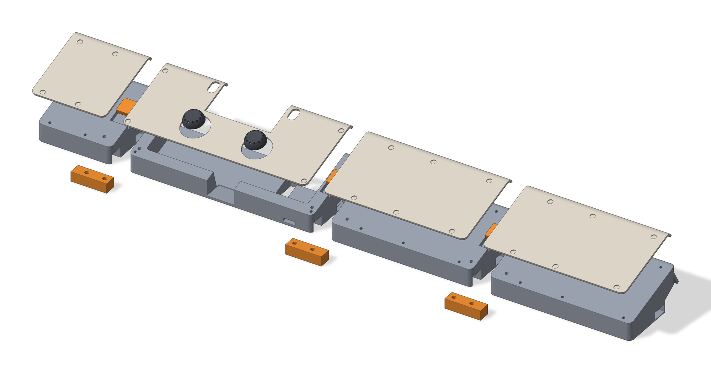

# cad/ - the parametric sources

Everything printable in this project is generated from the Python files in this folder with
[build123d](https://github.com/gumyr/build123d). One parameter file drives the cradle, the face
plate, the wrist extenders, the joint keys and the stick caps; `variants.py` turns it into the 34
STL files in [`../stl/`](../stl), `checks.py` measures the assembled result, and `render.py` draws
the pictures in [`../docs/images/`](../docs/images). Nothing here needs the printer, the slicer or
the controller.

Contents: [Files](#files) · [Regenerating everything](#regenerating-everything) · [The one-process rule](#the-one-process-rule) ·
[Frames](#frames) · [Switching variants](#switching-variants) · [Parameters](#parameters) · [What the checks measure](#what-the-checks-measure) ·
[Reading the code comments](#reading-the-code-comments)



## Files

| file | what it holds |
|---|---|
| `dock_params.py` | every dimension, the two frames, `configure()` for the variant axes, and the lip curve maths (`lip_curve`, `lip_inner`) |
| `cradle.py` | the cradle: `make_cradle()`, plus the joint cuts shared with the extenders (`spline_rebate`, `topkey_rebate`), the undercut, the hook, and the two keys (`make_spline()`, `make_topkey()`) |
| `faceplate.py` | the face plate: `make_faceplate()`; the `palm` and `full` plate styles; the lip profile |
| `extender.py` | the three wrist-extender pieces: `pieces()`, `make_base()`, `make_plate()`; their plate-screw stations |
| `stick_cap.py` | the analogue-stick caps: `make_cap(clear)`, the swing arithmetic, a six-cap test set |
| `dock_fit.py` | a fit check of cradle + plate + a board envelope: interference volumes, `--step` writes a STEP of the assembly |
| `variants.py` | builds the STL matrix into `../stl/`, verifying each B-rep and each written mesh |
| `checks.py` | the geometric verification suite (see below); exit status 1 on any failure, `--strict` to count the two documented `KNOWN` rows as failures too |
| `render.py` | the six images in `../docs/images/`: two shaded renders, two labelled grids, two SVG drawings |

Three products are modelled as they are printed: the cradle and the extender bases bottom-down in the
world frame, the face plates flat in the part frame with their underside at z = 0 (flipped face-down
for printing by `variants.py`), the keys and caps flat at the origin.

## Regenerating everything

```
python cad/variants.py                     # all 34 STL files into stl/, about a minute
python cad/variants.py --list              # the catalogue, builds nothing
python cad/variants.py --only cradle_std_hook
python cad/variants.py --only "*_tall_*"   # globs on the file stem work too

python cad/checks.py                       # the printed configuration + every file in stl/
python cad/checks.py --all                 # every height x hook combination
python cad/checks.py --height low --hook nohook --no-stl
python cad/checks.py --strict              # the two KNOWN rows (see below) count as failures

python cad/render.py                       # docs/images/, one to two minutes
python cad/render.py --only hero plan --scale 0.4

python cad/dock_fit.py [--step]            # interference report; the STEP goes to cad/out/
python cad/stick_cap.py                    # swing report + the six-cap test set into cad/out/
```

Run them from the repository root; every path inside the scripts is relative to the script's own
location, so they also work from anywhere else. `cad/out/` is scratch and is not committed.

Requirements: Python 3.11 or newer (I use 3.14), `build123d` 0.11 (which brings the OCP kernel),
`numpy`; `render.py` also wants `Pillow` and uses `matplotlib` only to find its bundled DejaVu font,
falling back to Pillow's own font if matplotlib is absent. No script installs anything.

Slicing is not in the repository: it was done with Bambu Studio's command-line slicer and the exact
settings are in [`../docs/PRINTING.md`](../docs/PRINTING.md), together with the per-file results.

## The one-process rule

Each script is a single plain process: it imports build123d, builds, writes, exits. There is no CAD
server, daemon or notebook kernel to keep alive, no cached state between runs, and nothing to
reconnect to. The boolean-heavy parts take seconds - the cradle builds in under two seconds, the whole
assembled dock in well under a minute - so there is nothing to be gained by keeping a session warm, and a lot
to be gained by every run starting from the sources: what you get is exactly what the files say.

The same rule applies to the geometry: parts never import each other's *results*, only each other's
*cuts*. The extender bases are `cradle.body()` over their own x range with `cradle.spline_rebate()`
and `cradle.topkey_rebate()` cut into them, so both halves of every seam come from one function and
cannot drift apart. `checks.py` tests exactly the cuts the parts were made with, not a copy of them.

## Frames

Two right-handed frames, both in millimetres:

- **W, the world (desk) frame.** z = 0 is the desk; +y points toward the keyboard, +x to the right,
  +z up. The cradle and the bases are built here, bottom-down.
- **P, the part frame.** The frame the board and the face plate live in: origin at the PS-button
  centre on the pocket floor (the board's back), x right, y up the slope toward the keyboard, z out of
  the board face. P is W tilted `tilt` = 17° about x, pivoting on the user-side pocket edge, the line
  y = `y_cut`, z = `floor_h`.

The transform is `dock_params.P`, a build123d `Location`, applied as `p.P * shape`; `to_world(x, y, z)`
is the same thing as plain arithmetic:

```
y_w = y_cut + (y - y_cut)·cos(tilt) - z·sin(tilt)
z_w = floor_h + (y - y_cut)·sin(tilt) + z·cos(tilt)
```

Why two frames: the top face of every piece is the plate-seat rectangle drawn in P at the rim height
`h_top`, then extruded straight down to the desk. So the walls are vertical and the bottom is flat (in
W), while the plate outline, the rim and every screw pilot line up with the plate by construction (in
P). The pilots are drilled square to the plate, not to the desk; the top key is seated parallel to the
plate; the spline sits in W because it is a block in the vertical front wall.

`floor_z(y_w)` gives the pocket floor's height at a W y. Read `p.P` and the other derived values at
call time (`import dock_params as p`, then `p.P`); `from dock_params import P` would copy a value that
`configure()` later replaces.

## Switching variants

`dock_params.configure(floor_h=1.0, hook=False, plate_style="full")` sets any parameter by name and
recomputes the derived block (`y_cut`, `ox0/ox1`, `oy0/oy1`, `plate_top`, `open_y`, `h_top`, `screws`,
`ext_screw_ys`, `pocket`, `P`). The module's own values are the printed configuration. The three
axes the STL matrix varies:

| axis | names in the file names | parameter | values |
|---|---|---|---|
| height | `low` / `std` / `tall` | `floor_h` | 1.0 / 2.0 / 3.5 mm, the pocket floor above the desk on the pivot line |
| hook | `hook` / `nohook` | `hook` | the lip that hangs over the keyboard's front edge, on or off |
| plate style | `palm` / `full` | `plate_style` | d-pad, face buttons and PS filled, or every control open |

`floor_h` raises the cradle and the bases together and leaves the face plate alone (it is built
relative to the rim), which is why the heights share one plate. The hook changes only the keyboard
end. The plate style changes only the plate.

## Parameters

All in `dock_params.py` unless noted, all in millimetres, all with the printed values. Points are
(x, y) in P. "ASSUMED" marks a number that was never measured with an instrument.

**The part (the cut-down board + midframe)**

| parameter | value | meaning |
|---|---|---|
| `body_w`, `body_h` | 130, 55 | the rectangle the cut-down midframe + board occupy, traced 1:1 |
| `body_bottom` | -11 | its bottom edge below the PS-button centre; also the pivot line `y_cut` |
| `body_r` | 2 | corner radius of that rectangle |
| `pocket_clear` | 0.5 | pocket clearance per side |
| `stack_h` | 15 | midframe face to the rearmost point on the board; sets the rim height. ASSUMED (14 until v11, when the plate bowed) |

**Face plate**

| parameter | value | meaning |
|---|---|---|
| `plate_t` | 1.6 | plate thickness |
| `plate_gap` | 0.6 | midframe face to plate underside (the button pads live here); `h_top = stack_h + plate_gap` |
| `hole_clear` | 0.8 | added to every hole diameter and width |
| `plate_hole_d`, `plate_cbore_d`, `plate_cbore_depth` | 2.0, 4.0, 0.8 | the screw hole: through diameter, head recess diameter and depth from the top face |
| `plate_hole_skin` | 0.2 | skin left across each hole at the bottom of its recess so the face-down print needs no support there; poke through |
| `plate_screw` | 4.4 | legacy (plates v1-v3): M3 holes with float; unused since v6 |
| `holes_dx`, `holes_dy` | 0, 0 | a global shift of every control hole, if the pattern is off |
| `touchpad_c`, `touchpad_wh` | (-0.2, 26), 52.4 x 22 | the touchpad window; it runs open to the keyboard edge |
| `tp_notch_drop` | 2 | the window's bottom edge sits this much lower than the touchpad's |
| `stick_l`, `stick_r`, `stick_d` | (-25.2, -2.5), (24.8, -2.5), 18.6 | stick centres and the shell's hole diameter |
| `stick_travel` | 2.6 | extra on the stick holes (they are 22.0 as cut) |
| `ps`, `ps_d` | (-0.2, -0.2), 8 | PS button; open only in the `full` plate |
| `btn_cross`, `btn_triangle`, `btn_circle`, `btn_square`, `face_wh` | (48.6, 10.1), (48.6, 31.3), (60.2, 20.5), (36.9, 19.9), 10.4 x 8 | face buttons; round holes of max(`face_wh`) + clearance in the `full` plate |
| `dpad_c`, `dpad_arm`, `dpad_w`, `dpad_grow` | (-49, 21.5), 7.5, 9.2, 0.5 | d-pad cross centre, arm length, bar width, extra growth per edge (`full` plate) |
| `share`, `options` | (-32.1, 34.1), (32.8, 34.1) | the two slots; `so_slot_w` x `so_slot_len` = 6.6 x 11.0 stadium slots, long axis along y, `so_tilt` 0. ASSUMED - measure the caps |
| `plate_style` | `"palm"` | `"palm"` (printed) or `"full"` |
| `lip`, `lip_R`, `lip_R_end`, `lip_angle`, `lip_y_start` | True, 8, 3, 90, 37 | the curled keyboard end: starts at the top of the touchpad window tangent to the face, turns 90° with the radius shrinking linearly from 8 to 3 (closed-form arc integrals in `lip_curve()`); `lip_R_end` must stay above `plate_t` |

**Pose**

| parameter | value | meaning |
|---|---|---|
| `tilt` | 17° | the face rises toward the keyboard |
| `floor_h` | 2.0 | pocket floor above the desk on the pivot line; the height axis |

**Cradle**

| parameter | value | meaning |
|---|---|---|
| `wall`, `rim`, `corner_r` | 3, 6, 4 | pocket wall thickness, rim width outside it, plan-view corner radius |
| `pilot_d`, `pilot_depth` | 2.0, 10 | plate-screw pilots, blind, square to the plate |
| `notch_d` | 22 | finger notch through the user-side wall, down to the floor |
| `beyond_plate` | 3.5 | the cradle runs this far past the plate's flat part; no wall at the keyboard end, the pocket runs out open |
| `chan_x`, `chan_w`, `chan_d`, `chan_y0_shift` | 35, 10, 5, 10 | channel in the pocket floor for the charging-board ribbon connector: centre, width, depth, and how far past the user-side pocket edge it starts |
| `bottom_slot_y` | (-1.1, 19.1) | W y range of the channel's opening through the underside |
| `back_slot_x1` | 45 | the channel's exit in the keyboard-end face widens to this x |
| `kb_cut_len`, `kb_cut_h_inner`, `kb_cut_h_end` | 14, 10, 18 | the keyboard undercut: a right trapezoid along the whole keyboard side, 14 along the desk, 10 tall inside, 18 at the end face |
| `hook`, `hook_ext`, `hook_t`, `hook_drop` | True, 2, 2, 4 | the hook: the arm above the undercut carries on 2 past the end face along its own line and the last 2 of it drops 4, square to that line |
| `hook_side_w` | 9 | on the cradle the hook sits only on the two side walls, this wide; 0 = a full-width bar (which fouled the board) |
| `kb_wall_h`, `kb_cham_angle`, `kb_top_h` | 10, 30°, 18 | the K70's front edge as traced on paper, for a clash report only, never a printed body. UNMEASURED |
| `led_notch_w`, `led_notch_h`, `led_notch_x_shift` | 10, 3, 5 | notch for the charging board's LED end in the user-side wall, at floor level, in from the pocket's right corner |
| `jds_wh`, `jds_z0`, `jds_end_skin` | 33 x 21, 1, 2 | charging-board (JDS-055) bay under the floor at the right of the keyboard end: size (ASSUMED), bottom height, skin to the end face |
| `cable_w`, `cable_notch_w` | 9, 6 | legacy port-hole width in the right face and the minimum left of it after the undercut; the port is now the extenders' cable channel section |
| `dowels` and `dowel_*` | False; 6.2 dia, 7.5 deep, z 9, W y -10 and 14, teardrop | the v1-v9 pins for a wrist-rest extension, retired for the spline joint; kept as a switch |

**The joint (cradle <-> extender, extender <-> extender)**

| parameter | value | meaning |
|---|---|---|
| `joint_spline` | True | the loose spline in the front wall |
| `spline_x_in`, `spline_x_out` | 9, 20 | how far the spline reaches into the dock-side piece (inside its 9 mm side wall) and into the solid outboard piece |
| `spline_t`, `spline_y` | 8, (-22, -12.5) | spline height from the underside and its W y span, inside the solid front wall |
| `spline_clear` | 0.25 | seat clearance per side |
| `spline_screw_in`, `spline_screw_out` | 4.5, 10 | the two M3 self-tappers up through the spline, this far from the seam into each piece |
| `screw_clear_d`, `screw_head_d`, `screw_head_depth`, `screw_pilot_d`, `screw_pilot_depth` | 3.2, 5.6, 2.2, 2.4, 9 | clearance hole and counterbore in the spline, pilot up into the piece above |
| `topkey` | True | the second connector: a flat key in a rebate in the rim's top face, trapped by the plate |
| `topkey_y`, `topkey_t` | (2, 14), 3 | its P y span (between the two screw rows) and thickness |
| `topkey_x_in`, `topkey_x_out` | 7, 14 | reach into the dock-side piece (leaving 2 of pocket wall) and the outboard piece |
| `topkey_clear` | 0.2 | per side, and the rebate is this much deeper than the key, so it can never lift the plate |

**Wrist extenders**

| parameter | value | meaning |
|---|---|---|
| `ext_len_left`, `ext_len_right_total` | 60, 230 | left and right lengths: 60 + 149 + 230 = 439 mm, 2 mm over the K70's 437 |
| `ext_right_split` | 2 | the right one prints as two 115 mm pieces |
| `ext_cable_y`, `ext_cable_z0`, `ext_cable_z1` | (7, 19.5), 0.8, 6.8 | the cable channel through every piece, sized so a micro-USB plug threads end to end; the cradle's wall port has the same section |
| `ext_cable_gable` | 1.4 | legacy (v2 one-piece extender): a gabled channel roof; the v3 channel is a plain rectangle |
| `ext_plate` | True | v3: every piece is a base plus its own face plate |
| `ext_screw_inset`, `ext_screw_pitch` | 8, 60 | plate screws this far in from each end, with pairs added so no span exceeds 60 |

**Derived (computed by `_derive()`, never set by hand)**

| name | value | meaning |
|---|---|---|
| `y_cut` | -11 | the pivot line = `body_bottom` |
| `ox0`, `ox1` | -74.5, 74.5 | the cradle's x extent: half the body + clearance + wall + rim |
| `oy0`, `oy1` | -20, 40.9 | the rim's P y extent: `y_cut - wall - rim` to `plate_top + beyond_plate` |
| `plate_top` | 37.4 | top of the touchpad window = the end of the plate's flat part |
| `open_y` | 38.4 | where open-ended holes run out past the plate edge |
| `h_top` | 15.6 | the rim = plate underside, in P z |
| `screws` | (±71.3, -16.5), (±71.3, 33.9) | the cradle's four plate screws, 3.2 in from the ends and 3.5 from the rim's edges |
| `ext_screw_ys` | (-16.5, 33.9) | the extenders use the same two rows, so the screw line runs straight across |
| `pocket` | (-65.5, -11.5, 65.5, 44.5) | the pocket rectangle in P |
| `P` | Location | the P -> W transform |

**Stick caps (`stick_cap.py`)**

| parameter | value | meaning |
|---|---|---|
| `socket_wl`, `socket_depth` | 3 x 3.5, 4 | the hollow socket for the bare stick post (ASSUMED post size; three fits are printed) |
| `boss_d` | 7 | the boss around the socket, >= 1.2 of wall at its corners |
| `TOP`, `cap_d`, `skirt_d`, `skirt_wall` | 5.2, 12, 16, 1.2 | total height, diameter at the top and at the skirt, dome wall |
| `cap_t`, `dish_r`, `dish_depth` | 1.2, 4.5, 0.35 | solid thickness over the hollow, the thumb dish |
| `flutes`, `flute_r` | 12, 0.7 | the grip scallops round the edge |
| `fits` | 0, 0.25, 0.5 | socket oversize steps of the test set (= `tight`, `nominal`, `loose` in `stl/caps/`) |
| `plate_hole_d` | 22 | the plate's stick opening, for `swing_report()` |

## What the checks measure

`python cad/checks.py` builds the assembled dock from the sources - cradle, plate, the three bases and
their plates, the splines and top keys placed in their seats - and prints one PASS/FAIL row per
measurement:

- **(a) seams:** the top of base + plate is probed 5.6 mm either side of each of the three seams at
  W y -15, 0, 15 and 28; the plate tops and the base rims must each agree to three decimals.
- **(b) keys:** each spline and each top key in its seat has 0.000 mm³ of interference with the
  pieces it joins (the key also with the two plates that trap it).
- **(c) rebates:** the cradle's key seats do not break into the pocket or the charging bay.
- **(d) pilots:** every plate-screw pilot has >= 3 mm of material under its tip along its own axis and
  does not open into a key seat, a key-screw pilot or a cable channel.
- **(e) hook:** with the hook on, the material past the cradle's end face is exactly the two side
  walls and the middle is clear at x 0, ±30, ±60; with it off, nothing is past the end face.
- **(f) caps:** the dome's sphere centre is at or below the bed (no overhang); the three caps are
  valid single solids.
- **(g) files:** every STL in `stl/` is one closed, consistently oriented shell.

The printed configuration passes every row (`ALL CHECKS PASSED`, exit 0) with two rows reported as
`KNOWN` instead of FAIL: the cradle's two front plate-screw pilots, 3.2 mm in from the ends, open
into the roof of the spline seat after 7.4 of their 10 mm, 1.9 mm from the spline's own M3, so a long
plate screw there would meet both. The row prints the longest screw that stays clear of the M3
(4.6 mm, plate included) and the longest that stays out of the seat (9.0 mm). The suite found this on
2026-10-22, after the part had been printed; it is documented in
[`../docs/PRINTING.md`](../docs/PRINTING.md#assembly-notes) rather than fixed, because the fix
moves two holes in a plate that exists. `--strict` counts the two rows as failures (exit 1), and
deleting the `KNOWN` entry in `checks.py` does so for good. `--all` repeats the suite for every
height x hook combination; the same two rows are the only deviation in all six.

## Reading the code comments

The comments in these files are a design log, kept as the parts went through eleven versions, and
they say "owner" where they mean me, the author - the person who printed each version, found what was
wrong with it and asked for the next change. Dates in the comments are the dates of those changes;
[`../docs/CHANGELOG.md`](../docs/CHANGELOG.md) condenses them and [`../docs/DESIGN.md`](../docs/DESIGN.md)
explains the decisions.
