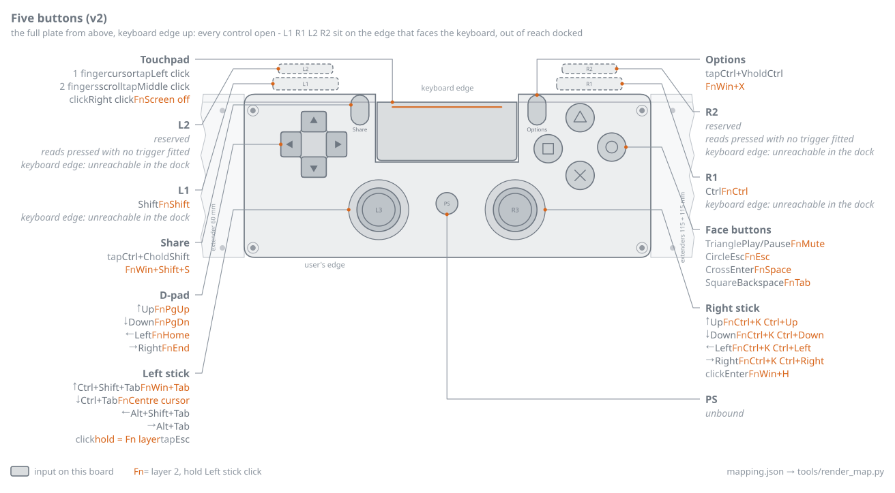

# Control map v2 - design (2026-10-21)

Settled on 2026-10-21. This is the reference for what each input does and why; the shipped defaults in [`../mapping.json`](../mapping.json) and the docstring of [`../ds4_dock.py`](../ds4_dock.py) implement exactly this map, and [`tools/mapping_editor.py`](../tools/mapping_editor.py) edits it. The picture of it is [`images/map.svg`](images/map.svg).

## The hardware reality that drives all of this

The controller was cut down for the dock. **The only inputs that physically exist are:**

- the **touchpad** surface (two contacts) and its **mechanical click**
- **both analogue sticks** and their clicks, **L3** and **R3**
- **Share** and **Options**

That is five discrete buttons. Gone with the shell: L1/R1 (which were Shift and Ctrl), Cross
(Enter), Circle (Esc), Square (Backspace), Triangle (play/pause), the whole d-pad (arrows), and
PS (which toggled layer 2). L2/R2 report permanently pressed at 255 with the triggers removed;
nothing is bound to them and nothing should be - the mapping loader refuses to bind them.

*[`images/map_full.svg`](images/map_full.svg): the same `mapping.json` in the editor's **Full controller**
mode - the dock's `full` face plate, to scale, with the d-pad, the face buttons and PS open - so the
dormant bindings, the ones a board that keeps its buttons would bring back, are visible too. L1, R1,
L2 and R2 are drawn along the keyboard edge but marked unreachable: that edge faces the keyboard in
every dock variant. Regenerate it with
`python tools/render_map.py mapping.json docs/images/map_full.svg --mode full`.*

Two consequences shape the design:

1. **Fixed chords need no physical modifier.** The mapper synthesises `ctrl+c` as a keystroke, so
   Share can send it with no Ctrl button in existence. Only *live* modification of the stick -
   "select while I move" - needs a genuinely held key, and that needs exactly one.
2. **One momentary layer buys back everything else.** Holding L3 is `Fn`. This rides the layer
   mechanism that was already in the file (`KEYMAP_L2`), momentary instead of toggled.

## The map

| Input | Alone | Held | **Fn** (hold L3) + it |
|---|---|---|---|
| **Pad click** | right click | - | **suspend injection** (toggle) |
| Pad, 1 finger | cursor; tap = left click | - | - |
| Pad, 2 fingers | scroll; tap = **middle** click | - | - |
| **Right stick** | **arrows**, repeat rate by deflection | - | **pane focus** `ctrl+k ctrl+<arrow>` |
| **Left stick** | flick W/E = prev/next window, N/S = prev/next tab | - | **flick N = Task View** (`super+tab`) **flick S = `cursor_centre`** |
| **L3** | **Esc** | **Fn** | - |
| **R3** | **Enter** | - | **voice typing** (`super+h`) |
| **Share** | `ctrl+c` | **Shift** - the stick selects text | **snipping tool** (`super+shift+s`) |
| **Options** | `ctrl+v` | **Ctrl** - the stick jumps by word | **`super+x`** |

Share + Options held together give Shift+Ctrl, so the stick selects by word.

### Why these three, and why they fit

Task View, `Win+X` and right-click's context menu are all **menus driven by arrows and Enter** -
which is exactly what the right stick and R3 now are. Open, steer, confirm, with both thumbs
already on the sticks and never a reach for the keyboard.

Enter and Esc go on the stick clicks because they are the two keys every dialog and prompt needs
and they were lost with Cross and Circle.

## Mechanisms

**Tap vs hold** (Share, Options, L3). The modifier engages at `hold_s` (0.25 s), *not* on press.
Release before `hold_s` fires the tap action instead. This way a tap never leaves a stray Shift
press behind - which matters, because five stray Shift presses trip Windows Sticky Keys.

**Fn has zero latency.** Layer 2 engages the instant L3 goes down, so `Fn + stick` responds at
once. Esc fires on L3 *release*, and only when the press was shorter than `hold_s` **and** nothing
else was pressed during it. So holding L3 to use `Fn + Share` never also sends Esc.

**In layer 2 the tap/hold split does not apply.** Share, Options and R3 fire their layer-2 action
on press. Otherwise `Fn + Share` would wait 0.25 s to find out whether it was a tap, for a layer
that has no tap meaning. A modifier already held when Fn engages - Shift from Share, say - stays
held until that button is released; Fn does not disturb it.

**Right stick as arrows.** The dominant axis wins, so diagonals resolve to one arrow rather than
two. The first key fires the moment the stick leaves the deadzone, then repeats at a rate that
scales with deflection through `stick_expo`: `rstick_rate_min` just past the deadzone up to
`rstick_rate_max` at full travel. This is the usual key-repeat feel, with the push distance acting
as the speed control.

**Right stick under Fn** uses the existing flick mechanism (`flick_on` / `flick_off` hysteresis),
so it fires once per push rather than repeating - a pane jump should not machine-gun.

**Suspend.** `Fn + pad click` toggles it. On entering: `release_all()` first, so nothing is left
held down, then stop injecting entirely. The light goes dim red. The same chord resumes.
It is deliberately a two-handed chord: my first choice, Share+Options, collides with
Shift+Ctrl - pausing mid-selection would have suspended the mapper. In `mapping.json` this is the
`{"action": "suspend"}` binding under `Pad`'s `fn` slot, so the editor can move it.

## The light bar

Not on all the time. Highest priority wins:

| Priority | State | Colour |
|---|---|---|
| 1 | suspended | dim red |
| 2 | attention requested | orange, steady |
| 3 | Fn held (layer 2) | magenta |
| 4 | any input within `led_idle_s` | blue |
| 5 | idle | **off** |
| - | first 2 s after plug-in | battery colour, then hands over |

**"Input" has to be defined carefully or the blue never goes out.** The sticks idle off centre -
LS 128,125 / RS 129,123 on the phase-1 checklist - and jitter by a unit or two constantly, so raw
stick values cannot count as activity. Activity means: a button edge, a touchpad contact, or stick deflection **past the
deadzone**. L2 and R2 are excluded - they are stuck at 255 with the triggers gone and would
otherwise read as permanently active.

`led_report()` already does the work and already holds the rumble bytes at zero, with a self-test
asserting it. **The motors are physically removed: never write a non-zero rumble byte.**

**No flashing** (decided 2026-10-21). The pad can pulse in hardware through the report's flash
bytes, and the orange state originally did. It was tried on the bench and rejected: every state is
a steady colour, and the flash bytes stay at zero.

The light is visible in the dock: this is a v2 controller, whose light strip sits above the
touchpad, and the face plate's touchpad opening runs out past the plate's keyboard edge.

## The attention signal

For the orange state the mapper has to learn when something is waiting for me. Mechanism:

- a one-word file `attention_state.txt` next to the mapper (or wherever `--attention-file`
  points): `waiting` or `idle`; a missing file means idle
- the mapper polls its mtime every 0.25 s from the main loop, the same way it already polls the
  tune file, so the 250 Hz hot path never touches the filesystem

Anything that can write a file can drive it. The example this was built for is Claude Code, with
three hooks: `Notification` writes `waiting`; `Stop` and `UserPromptSubmit` write `idle`. A hook
that calls a shell directly can flash a console window on Windows; if yours does, launch it through
`pythonw.exe` with `CREATE_NO_WINDOW` rather than through a shell.

## What this took in the code (`ds4_dock.py`)

1. `MOUSEMAP["Pad"] = "right"`; `ACTIONS["Pad"]` dropped.
2. Two-finger tap: `{1: "left", 2: "right"}` became `{1: "left", 2: "middle"}`.
3. A momentary layer on L3 replacing the PS toggle, with the tap/hold rules above.
4. Tap-vs-hold for Share and Options, with the modifier engaging at `hold_s`.
5. Right-stick key mode: dominant axis, deflection-scaled repeat. The old cursor behaviour stays
   behind `rstick_mode = "keys" | "cursor"` rather than being deleted.
6. **Key sequences in the parser.** `_key()` used to split on `+` only, so it could not send VS
   Code's `Ctrl+K Ctrl+Left`. Now a space separates chords in sequence and `+` joins keys pressed
   together: `"ctrl+k ctrl+left"` is press-release `ctrl+k`, then press-release `ctrl+left`.
7. `led_for()` rewritten to the priority table, plus an activity timestamp and the plug-in grace.
8. Suspend state, the attention-file poller, and the new tune knobs:
   `hold_s`, `rstick_rate_min`, `rstick_rate_max`, `led_idle_s`.

Still one file - the mapper is deliberately a single script with no dependency beyond `hidapi` (the README's *How it works* says why).

## Nothing was removed without a home

| Was | Now |
|---|---|
| `cursor_centre` on pad click | `Fn` + left stick flick south |
| right click on R3 | pad click (my preference) |
| middle click on L3 | two-finger tap |
| right click on two-finger tap | middle click (three ways to right-click was one too many) |
| right stick as a coarse cursor | retired by choice; kept behind `rstick_mode` |
| battery colour always on | shown for 2 s on plug-in (it reads 100 % forever on USB) |
| volume on Share/Options | dropped: a dedicated volume controller already sits on the desk |

## Open

- `Fn` + left stick flick **W** and **E** are unassigned. Backspace and Delete are the obvious
  candidates once the stick is driving the caret, but I have not needed them yet.
- Deferred, not rejected: a touchpad scroll strip along the right edge, two-finger tap to Back,
  and knock detection on the live accelerometer.
- The repeat rates are guesses. They are tune knobs precisely so they can be set on the bench
  without a restart.
