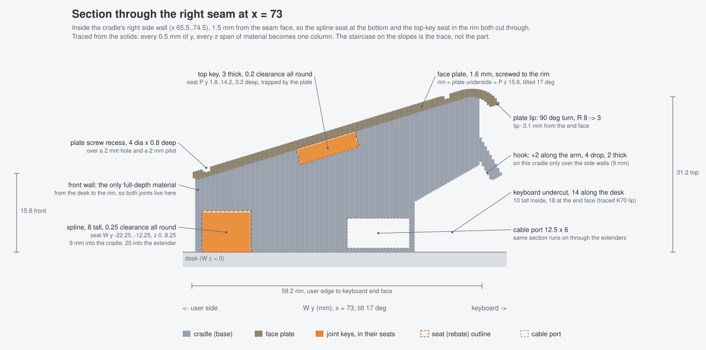
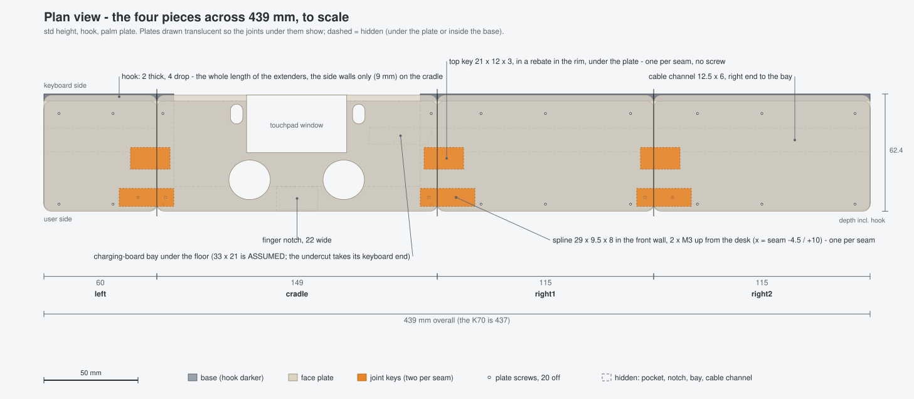

# Design notes

Why the frame is shaped the way it is. Everything here is in `cad/dock_params.py` and the part files; this document is the reasoning the code comments are too short for.

**TL;DR.** Two coordinate frames, and the rule that every feature is built in the frame it is native to. A face-plate lip whose radius tightens as it turns, from a closed-form integral. Extenders that are base + plate so the top finish and the flushness come from construction, not care. A joint of two loose keys per seam, placed where the only full-depth material is. A keyboard hook that can only be 9 mm wide on the cradle, and a bug where a "big enough" extrude silently stopped being big enough.


## The two frames

**W**, the world: the desk is z = 0, x runs right, y runs toward the keyboard, z is up. **P**, the part: origin at the PS button's centre on the pocket floor (the back of the board), x right, y up the slope toward the keyboard, z out of the board's face. P is W tilted `tilt` = 17 degrees about x, pivoting on the user-side pocket edge line (W y = `y_cut` = -11, z = `floor_h`):

```python
P = Pos(0, y_cut, floor_h) * Rot(X=tilt) * Pos(0, -y_cut, 0)      # P -> W
```

The board, the face plate, the pocket, the screw pilots, the top key and the lip all live in P. The desk, the keyboard undercut, the hook, the spline, the cable channel and the charging-board bay live in W.

### Why the top face is built in P and dropped to the desk

The cradle body is three lines: draw the plate-seat rounded rectangle in P at the rim height `h_top` (= `stack_h` + `plate_gap` = 15.6 mm), extrude it straight down 80 mm, and keep z >= 0. So the walls are vertical, the bottom is flat, and the plate outline, the rim and the four screw pilots line up with the plate in P **by construction** - the pilots are cylinders in P, square to the plate they receive.

The first OpenSCAD cradle (v0, 2026-09-22) did it the other way: a tilted floor with the top set a *vertical* `stack_h + plate_gap` above it. The review on 2026-09-24 found the plate landing 3.8 mm up-slope of the board with a 0.1 mm gap, vertical pilots that missed the tilted plate holes, and the right wing dowel sitting inside the USB bay. Every one of those was a feature built in the wrong frame.

One consequence worth knowing: `floor_h` is the only number that sets the dock's height. The cradle and the extenders both drop their top plane straight to the desk, so raising `floor_h` raises them together, while the face plate - built in P relative to the rim - is unaffected. That is why the height variants (`low` 1.0, `std` 2.0, `tall` 3.5 mm) share one face plate, and why plate v9 did not need reprinting when v10 went a millimetre taller.

## The spiral lip

The face plate's keyboard end does not stop square: it curls down and finishes pointing straight at the desk, hiding the rim's end and following the touchpad's own top edge, which on the scan is flat for about 21 mm and then drops 5.6 mm over 7.6 mm - close to an 8 mm radius through about 73 degrees. Plate v8 used exactly that: one radius, 73 degrees. Plate v9 wanted the end to turn a full 90 degrees but stay flush with the touchpad where the two meet, which one radius cannot do. So the radius shrinks linearly with the turn angle: `lip_R` = 8 mm at the start (the touchpad's own) down to `lip_R_end` = 3 mm at the tip, through `lip_angle` = 90 degrees.

With `A = lip_angle` in radians, `k = (lip_R_end - lip_R) / A` and `R(a) = lip_R + k a`, the top surface is the arc integral, which has a closed form for R linear in a:

```
dy(a) = ∫₀ᵃ R(a) cos a da = lip_R·sin a + k·(a·sin a + cos a − 1)
dz(a) = ∫₀ᵃ R(a) sin a da = lip_R·(1 − cos a) + k·(sin a − a·cos a)
```

so a point of the top surface is `(lip_y_start + dy, plate_t − dz)` in P, starting at the top of the touchpad window (P y 37.0) tangent to the flat top. That is `dock_params.lip_curve()`. The underside, `lip_inner()`, is the same curve offset `plate_t` toward the centre of curvature, i.e. along `(−sin a, −cos a)`. The offset is why `lip_R_end` must stay above `plate_t` (3.0 against 1.6): the inner radius is `R(a) − plate_t`, and at the tip it is 1.40 mm - go lower and the underside arc inverts. The tip ends 6.2 mm past y 37.0 and 4.8 mm below the top face (v8: 7.7 and 5.7), curling under rather than reaching further.

One parametrisation, three consumers: the plate's lip profile (`faceplate.lip_profile`), the cut in the cradle's rim that makes room for it (`cradle.plate_lip_clearance`, built from the `lip_inner` points - a box minus a cylinder only works for one radius), and the extender plates, which carry the same profile over their own x range. Plate-on-cradle intersection was verified at 0.000 mm³ when v9 was built (2026-10-06).

## Why the extenders are base + plate

Extender v2 was one solid whose top surface *was* the plate's surface. It came back from the printer wrong in two ways: printed face down it was smooth instead of carrying the textured sheet's finish, so it did not match the plate next to it; and it did not sit flush.

v3 (2026-10-12) builds every extender piece the way the dock itself is built: a **base** whose top is the rim plane - literally `cradle.body()` over that piece's x range, with the same keyboard undercut, hook, lip clearance and cable channel - plus its own flat **face plate**, the real plate's outline, thickness, lip and screw spec over the same range, with no control openings. Now:

- the plate prints face down on the textured sheet exactly like plate v9, so the finish matches by construction;
- the base prints bottom-down and needs no support under the wrist surface at all (v2 needed 1700-2400 s of it);
- the mating surface is the same plane as the cradle's rim and the total height is the same `h_top + plate_t`, because both parts come from the same parameters as the real cradle and the real plate. In the CAD the assembled top surface comes out **identical to three decimals at all three seams** - a probe of the model, not calipers on the print; `cad/checks.py` section (a) is that probe, run on every build.

The plates use the cradle's own two screw rows (P y -16.5 and 33.9), so the screw line runs straight across all four pieces: 4 screws on the left plate, 6 on each right plate. A screw station that would land in a spline rebate is pushed clear of it rather than dropped, which keeps the two rows aligned.

One more thing the base inherits: the cradle's plan-view corner radius. The first extender squared off its inner end, which overhung the cradle's 4 mm corner round-over by up to 4 mm - the joint cross-sections disagreed by +7.1 % on the left and +10.4 % on the right. The rounded rectangle has to span exactly the piece, so its inner end's rounding mirrors the cradle's and the two sections meet with nothing overhanging.



## The joint

### Why the dowels went

v1-v9 joined the wrist pieces to the cradle with two 6.2 mm pins (teardrop holes, so PETG printed them without supports inside). Two small round pins in a flat butt joint resist almost nothing in twist, and the extenders were badly wobbly.

### Why a loose spline, and where

A flat tongue kills the twist with a large flat contact. Growing it onto the cradle would make the cradle 185 mm wide, which does not fit the 180 mm bed; growing it onto the extender would make it an 18 mm cantilever hanging in mid-air in a face-down print. As a **loose spline**, both parts get only a rebate and neither grows nor gains an overhang: the cradle's rebate opens at the bed (its roof bridges the 10 mm seat, routine) and the extender's opens toward the sky.

Where it can go is forced by the cradle. Under the pocket the floor is only 1.8-3.1 mm thick, so a rebate there breaks straight into the pocket; behind W y 20.4 the keyboard undercut has removed the base entirely. The only full-depth material is the **front wall**, W y about -23.9 to -12, solid from the desk to the rim. So the spline lives there, tall rather than wide (8 mm high, 9.5 mm in y), because height is what stops the extender hinging up at its far end. It is asymmetric - 9 mm into the dock side, which keeps that half inside the 9 mm side wall and clear of the pocket, and 20 mm into the solid extender - with an M3 clearance hole each side (3.2 mm, counterbored 5.6 x 2.2 mm from below) and a 2.4 mm self-tapper pilot in each part. Screw heads sit in the counterbores against the desk; nothing shows on top.

### The top key: making it a couple

On its own the spline sits at z 0..8 and fights a wrist pressing down on the far end of a 230 mm arm with an 8 mm lever and two screws. v11 adds a second connector per seam: a **21 x 12 x 3 mm flat key** in a shallow rebate milled into the rim's top face, 17 mm above the spline, hidden under the face plate - which also traps it, so it needs no screw. Tension at the top, compression at the bottom: a proper couple. The rebate is built in P so the key lies parallel to the plate, 7 mm into the dock side (leaving 2 mm of pocket wall standing full height) and 14 mm into the extender, 0.2 mm clearance per side and the same 0.2 mm deeper than the key is thick, so the key can never stand proud and lift the plate. Its rebate intersects neither the pocket nor the charging bay (0.00 mm³, checked), and printed bottom-down it opens straight at the sky.

Both halves of every seam are cut by the same two functions (`cradle.spline_rebate`, `cradle.topkey_rebate`) with the same numbers, so they cannot drift apart.



## The hook, and why it is 9 mm

The cradle's keyboard side is undercut along its whole length: a right trapezoid 14 mm along the desk, 10 mm tall at its inner edge and 18 mm at the end face (29.7 degrees), built to the K70's front lip as traced on paper - about 10 mm of vertical wall, then a 25-30 degree chamfer up to 18-20 mm. That profile is explicitly **unmeasured**. The arm above it carries on `hook_ext` = 2 mm along the undercut's own top line and the last `hook_t` = 2 mm of that drops `hook_drop` = 4 mm square to the line, hooking the keyboard's lip.

v10 ran that hook as a bar across the full width, and it fouled the board and the touchpad. It had to: the board overhangs the cradle's keyboard-end face by **3.6 mm** (the pocket runs out open there), and the hook's 2 mm extension at x = 0 lands at P y 38-41, z 3-11 - inside the board. The same fact caps the width: at the end face everything inboard of the two side walls is pocket, so a band wider than the wall would have nothing to hang off and would print as a bar bridging 131 mm in mid-air behind the board. Hence `hook_side_w` = wall + rim = **9 mm**: on the cradle the hook sits on the two side walls only and the middle 131 mm is clear. The extenders are solid and keep the hook over their whole length, so the assembled dock still has one continuous hooked arm each side - 69 mm on the left, 239 mm on the right. `nohook` variants simply leave the arm off.

## The extrude-reach bug

`keyboard_lip_cut()` draws the undercut as a polygon on the YZ plane and extrudes it across the width with `both=True`. The amount was 200 - that is +/-200 mm, and the cradle ends at x = +/-74.5, so it was plenty. Then the extenders arrived and the outermost right piece reached x = 304.5. Nothing failed: the outermost piece simply never got the undercut. It came out with a solid full-height keyboard wall and 21 cm³ too much plastic, and it cost a print. The fix was 600 (and the lip-clearance solid's reach went 400 to 800 for the same reason).

The lesson: a "big enough" constant is a hidden parameter. Either derive it from the geometry it must cover, or check every piece for the feature it is supposed to have - a volume comparison against the neighbouring piece would have shown 21 cm³ at once.

## Lessons

- **Measure by counting, not by reading.** The 1:1 tracing of the part was first read as 135 mm wide off the ruler labels and later re-measured at 130 by counting millimetre ticks between the ink edges. Five millimetres is a whole wall.
- **The scan is a reference, not a drawing.** The public-domain CUH-ZCT2 scans located the stick holes 3 mm higher than the real part (fitted 2026-09-24), and their midframe silhouette does not describe a cut-down board at all. Every hole position in the plate went through a printed fit.
- **Say what is assumed.** `stack_h` (15), the charging-board bay (33 x 21), the Share/Options slot size and "plate top flush with the touchpad" are marked `ASSUMED` in `cad/dock_params.py`; the K70 lip profile is marked `UNMEASURED` there; the 3 x 3.5 mm stick-cap socket carries no marker at all - `cad/stick_cap.py` lists it under "two guesses" in its docstring and prints three clearances instead of measuring. The face plate bowing upward over the 14 mm pocket is what an assumption looks like when it is wrong.
- **Build each feature in its native frame.** See the two frames above; every v0 fault was a frame mistake.
- **Make matching structural.** Extender base from the cradle's body, extender plate from the plate's outline, both halves of a seam from one function: flushness that cannot drift is worth more than flushness checked after the fact.
- **Orientation is a design input.** Printing the one-piece extenders on end cut support from 700-2400 s to 23-25 s and avoided stair-stepping the 17 degree wrist surface at 0.65 mm pitch; the base + plate split then made the question moot by giving each part an orientation with no support under what you touch. Teardrop holes exist because PETG tree supports grew into round ones.
- **Keep the retired path.** The dowel holes, the old right-stick cursor mode and the full-controller bindings are all behind switches rather than deleted. Two of them have already been useful again (the `full` face plate; the editor's full-controller mode).
- **Bed-fit rules come from failures.** 149 x 144.5 mm sliced; 157 x 149 pushed the tree supports off the bed. Three plates for the v11 set was the floor: 49 400 mm² of footprint against about 21 000 usable per bed, and a 115 mm body next to a 60 mm one is 179.
- **In the software, name the clock.** `Mapper.last_input` was in `time.monotonic()` and the main loop compared it with `time.time()`; the gap came out at ~1.7e9 s and the light would never once have gone blue. The self-test could not catch it because it never runs the main loop. Likewise, "activity" had to be defined as button edges, touch contacts and deflection past the deadzone - raw stick values jitter and L2/R2 are stuck at 255.
- **Two-handed chords for dangerous things.** Suspend was going to be Share + Options, which collides with Shift + Ctrl - pausing mid-selection would have suspended the mapper. It is Fn + pad click instead.

Further reading: [CONTROLS.md](CONTROLS.md) for the control map's reasoning, [HARDWARE.md](HARDWARE.md) for the teardown, [PRINTING.md](PRINTING.md) for how it prints, [CHANGELOG.md](CHANGELOG.md) for when each of these decisions was made.
